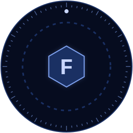
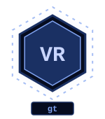
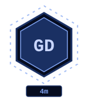
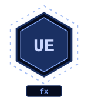
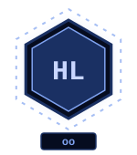

 

<table>
<tr>
<td width="30%" align="center">

</td>
<td width="70%">

I am <b>Fastest</b>, a hybrid legendary coding developer.

Five years of Unity scripting, design and building, shaping VR games inspired by Gorilla Tag. Four months of Godot. Now studying VFX and Unreal, and growing into ClickTeam Fusion.

Main weapons: <b>C#</b> and <b>C++</b>.

</td>
</tr>
</table>

  

